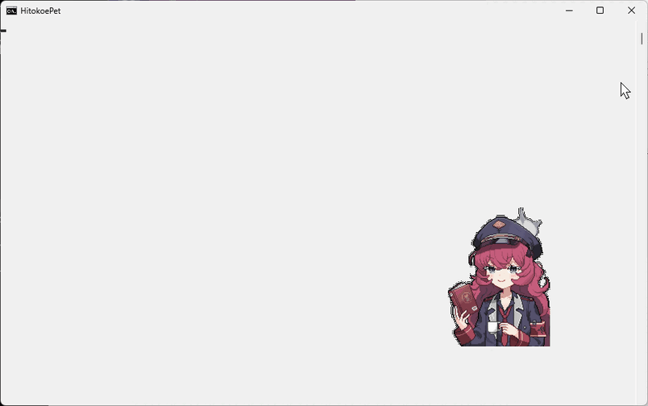
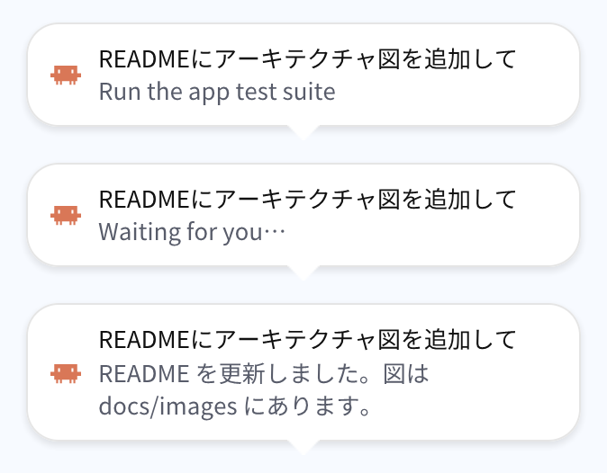
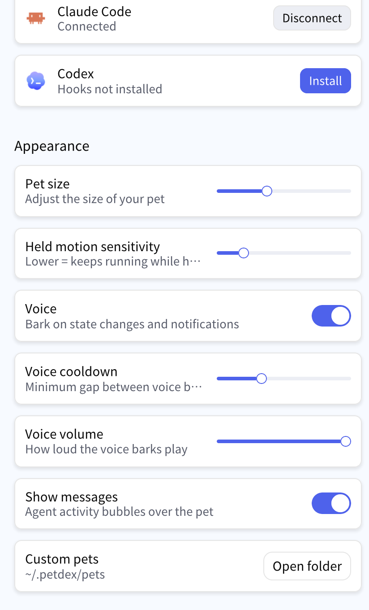
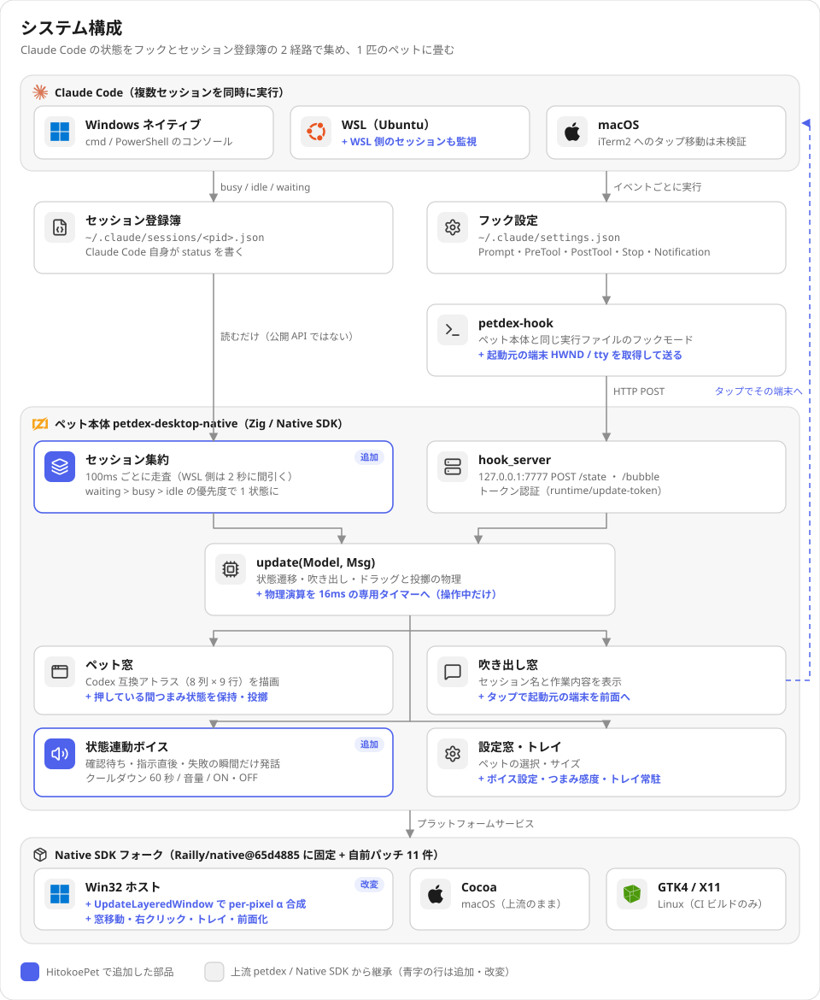
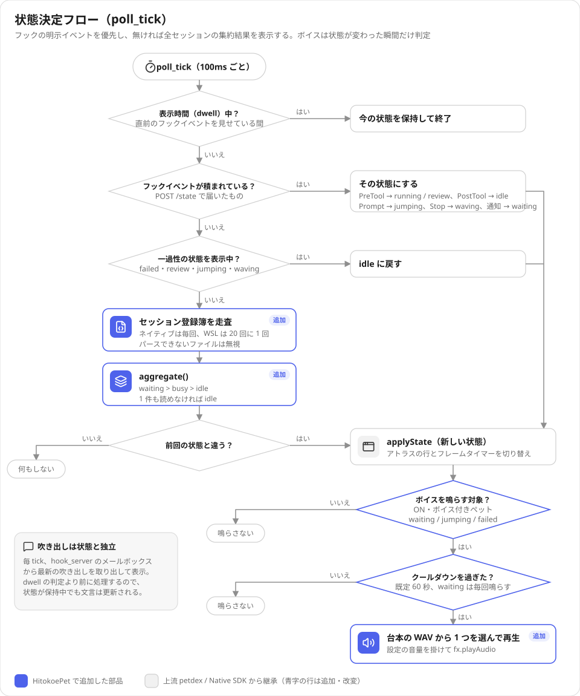
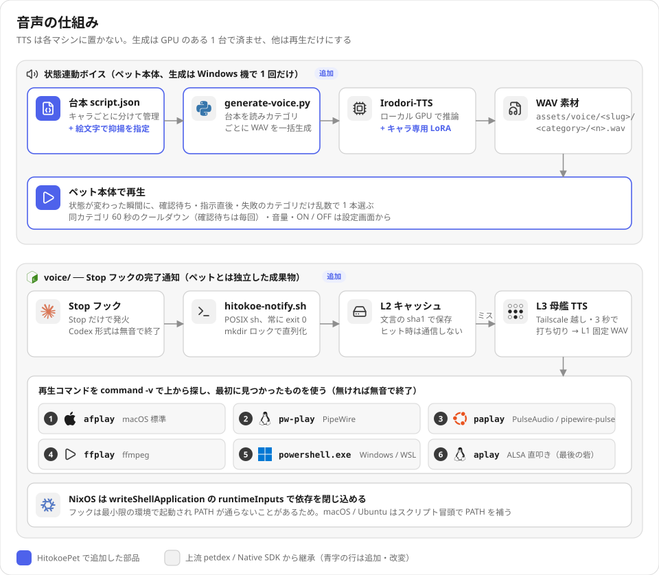
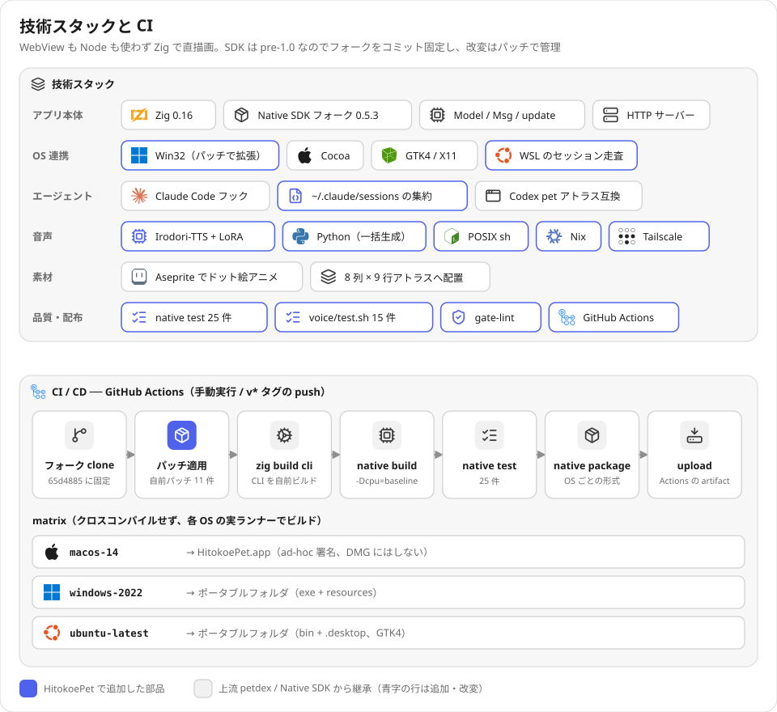
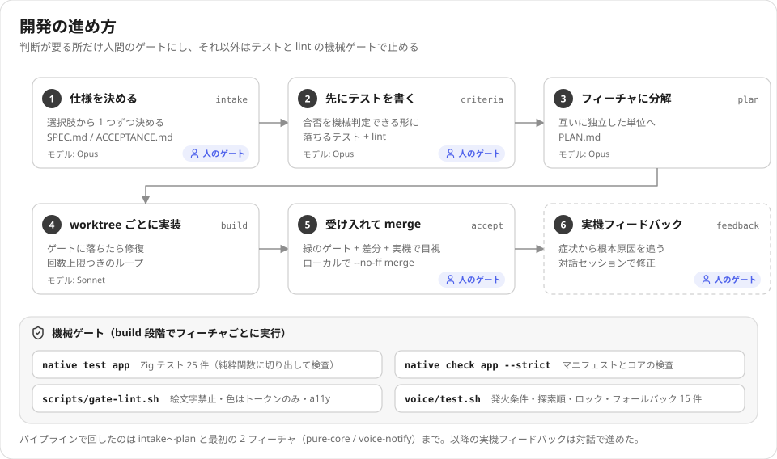

<div align="right">

[English](./README.en.md)

</div>

# HitokoePet

Claude Code の全セッションを 1 匹のデスクトップペットが代表し、確認待ちや作業の区切りを吹き出しと声で知らせる。
Codex pet のアトラス規格と互換。

<p align="center">
  
</p>
<p align="center"><sub>Windows 11 の実デスクトップで撮影。指示 → テスト実行 → 確認待ち → 別の窓に切り替える → 吹き出しを押すと元の端末が前面に戻る → つまんで動かす → 完了。<br>
吹き出しと状態はフックと同じ形式で流し込み、端末の出力は実際の <code>native test app</code>。カーソルは撮影時の実座標に描き足したもの。</sub></p>

複数のプロジェクトで Claude Code を並行して回すと、どのセッションが許可待ちで止まっているかを見落とす。
HitokoePet はセッションの数だけ通知を増やすのではなく、全体を 1 匹に畳む。許可待ちがあれば 1 匹が待ち顔になり、
吹き出しを押すとそのセッションが動いている端末が前面に来る。

上流 [petdex](https://github.com/crafter-station/petdex) の `packages/petdex-desktop-native`（MIT、Zig + Native SDK）を
`app/` に subtree で取り込み、そこに無い機能を足している。何を足したかは図の青い部品と `app/PROVENANCE.md` の改変表で追える。

## 機能と確認状況

| 機能 | 内容 | 確認状況 |
| --- | --- | --- |
| 多セッション集約 | `~/.claude/sessions/*.json` を 100ms ごとに読み、`waiting > busy > idle` の優先度で 1 状態に畳む。WSL 側のセッションも走査 | Windows + WSL 実機（ネイティブ 1 + WSL 3 の計 4 セッションを同時検知）。8 並走は未計測。終了済みセッションの残骸を拾う不具合あり（下の「既知の不具合」） |
| 吹き出しタップで端末へ | フックが起動した瞬間に自分の端末 ID（HWND / tty）を取得して吹き出しに添付。タップでその端末を前面に出す | Windows の個別コンソール窓と WSL ホスト窓で実機確認。macOS（iTerm2）はコードのみ |
| つまみ・投擲 | キャラ本体をつまんで動かせる。押している間はつまみ状態を保持し、離すと投擲物理 | Windows 実機。macOS は上流実装。Linux（X11）の窓移動は未実装 |
| 透過 | `UpdateLayeredWindow` による per-pixel α 合成（SDK フォークへのパッチ） | Windows 実機 |
| 状態連動ボイス | 確認待ち・指示直後・失敗の瞬間だけ発話。同カテゴリ 60 秒のクールダウン、音量、ON / OFF を設定画面から | Windows 実機（WAV は Windows 機のローカル TTS で事前生成） |
| トレイ常駐 | タスクバーに出さず通知領域に置く | Windows 実機 |
| `voice/` 完了通知フック | `Stop` フックで発話。再生コマンドを OS ごとに自動選択（macOS / Ubuntu / NixOS / Windows） | `voice/test.sh` 14 件合格・1 件スキップ（shellcheck 未導入）。WAV 素材の同梱と `settings.json` への登録はまだ |
| 3 OS ビルド | GitHub Actions で macOS（.app）/ Windows / Linux のポータブル版を生成 | 最新の手動実行（`43aa72a`）は成功 |
| 口パク | 事前計算した音量エンベロープから口形を決める設計 | **未実装**。口形を決める純粋関数とテストまで。描画への合成は未着手 |
| アイドル時 CPU | ドラッグ用の物理タイマーを操作中だけ動かす、WSL の走査を 2 秒に間引く | **削減は確認できていない**（下の「計測」） |

## スクリーンショット

<table>
  <tr>
    <td valign="top" width="50%">
      <br>
      <sub>吹き出し。上から作業中（ツールの説明）、確認待ち、完了時の最終メッセージ。1 行目はセッションの最初の指示。</sub>
    </td>
    <td valign="top" width="50%">
      <br>
      <sub>設定画面の後半。つまみ感度・ボイス ON / OFF・クールダウン・音量は HitokoePet で追加した項目。</sub>
    </td>
  </tr>
</table>


キャラクターは Aseprite でアニメーションさせた 11 フレームの GIF を、Codex 互換アトラス（8 列 × 9 行、セル 192×208px）の各行に割り当てている。
アトラス規格には手を入れていないので、Codex 用に作られた他のペットもそのまま読める。

<br clear="right">

## アーキテクチャ



状態を取る経路が 2 本ある。

- **フック経由**（上流の仕組み）: Claude Code のフックが `petdex-hook` を起動し、ペット内蔵の HTTP サーバーへ状態と吹き出しを POST する。
  ツール名や説明文が取れるが、全セッションが 1 つのペットに書き込むので最後に書いた者が勝つ。
- **セッション登録簿の集約**（追加）: Claude Code 自身が書き出す `~/.claude/sessions/<pid>.json` を全部読み、優先度で 1 状態に畳む。
  先行実装 3 つ（clawdex / claude-code-pet / petdex）はどれもこのファイルを読んでおらず、複数セッションを扱えていなかった（`docs/prior-art.md`）。
  公開 API ではない内部ファイルなので、読めないファイルは無視し、1 件も読めなければ idle に落ちる。フック経由の表示はそのまま動く。

`petdex-hook` はフックとして起動された時点で、自分がその端末の子プロセスであることを利用して端末 ID を取る
（Windows は `GetConsoleWindow()`、macOS / Linux は `ttyname`）。セッションの pid から端末を逆引きする必要がなく、WSL からでも同じ呼び出しで取れる。

## 状態決定フロー



## 音声



音声は 2 系統ある。

- **状態連動ボイス**（ペット本体）: 台本 `app/assets/voice/<slug>/script.json` を編集し、`python scripts/generate-voice.py --pet <slug>` で WAV を一括生成する。
  TTS（Irodori-TTS + キャラ専用 LoRA）は GPU のある Windows 機にだけ置き、ペットは生成済みの WAV を再生するだけにした。
  この TTS は台詞に絵文字を入れないと抑揚がほぼ付かないので、絵文字を擬音語・間投詞の直後に埋め込む書式にしている（`voice/samples/daihon.md`）。
- **`voice/` 完了通知フック**: ペットが載らない環境（ヘッドレス機など）にも配れる独立したシェルスクリプト。
  Codex 向けのスクリプトを流用すると、Claude Code の Stop ペイロードには `.type` が無いため「入っているのに一度も鳴らない」状態になる。
  `hook_event_name` だけを見て判定する。

## 技術スタックと CI



Native SDK は pre-1.0 で、npm 公開版（0.4.0〜0.6.1）は `app.zon` の `.floating` / `.transparent` を未知のフィールドとして拒否する。
上流と同じく `Railly/native@feat/floating-window-0.5.3`（`65d4885`）を固定し、Windows 向けの改変は `patches/native-sdk-fork/*.patch` の 11 件で管理している。
CI は毎回「固定コミットを clone → パッチ適用 → CLI を自前ビルド → アプリをビルド」をやり直すので、フォークをリポジトリに含めずに再現できる。

## 開発の進め方



Claude Code で開発している。判断が要る所（仕様・受け入れ基準・受け入れ）だけを人のゲートにし、それ以外はテストと lint で機械的に止めるパイプライン（`pipeline.yaml`、`scripts/run.sh`）を使った。
受け入れ基準は `ACCEPTANCE.md` に合否を機械判定できる形で書いてある。`main.zig` にはテストが 0 件だったので、状態選択・集約・口形決定・端末フォーカスを純粋関数に切り出してテストした。

## 計測：アイドル時 CPU

| 条件 | 1 コア比 CPU | RSS |
| --- | --- | --- |
| 上流 v0.3.1、macOS、91 秒（2026-07-28） | 22.7% | 111 MB |
| 本リポジトリ、Windows、45 秒 × 2 回（2026-10-11） | 17.4% / 16.3% | 55 MB |
| 上流（取り込み時点）、同じ Windows 機・同じ SDK フォーク、45 秒 × 2 回（2026-10-11） | 8.1% / 16.4% | 41〜47 MB |

同じ機械での比較では削減は確認できていない。上流側のばらつきが大きく、計測は Claude Code の実行セッション（対話デスクトップではない）で行ったので、
数値の差そのものより「減ったとは言えない」ことを結論にしている。Windows / Linux は SDK のソフトウェア描画経路（`gpu_present_path=pixels`）を通り、
差分転送の最適化が効かないことが分かっている（`docs/prior-art.md` 5.1）。原因の特定と目標値（`ACCEPTANCE.md` E1〜E3）は未完了。

## ビルドと実行

Zig 0.16 が必要。

```sh
# 1. 固定した Native SDK フォークを用意してパッチを当てる（CI と同じ手順）
git clone --branch feat/floating-window-0.5.3 https://github.com/Railly/native.git tools/native-sdk-fork
git -C tools/native-sdk-fork checkout 65d4885cb5f76a5d1f33cace56b93a898f7b2cb3
for p in patches/native-sdk-fork/*.patch; do patch -p0 < "$p"; done
(cd tools/native-sdk-fork && zig build cli)
export PATH="$PWD/tools/native-sdk-fork/zig-out/bin:$PATH"

# 2. ビルドとテスト
native build app
native test app
```

- ペット素材は `~/.petdex/pets/<id>/`（または `~/.codex/pets/<id>/`）に `pet.json` と `spritesheet.webp` を置く。
- Claude Code へのフック登録は設定画面の Agents > Claude Code から行う。
- ビルド済みのポータブル版は [Releases](https://github.com/terasaki-8910/HitokoePet/releases) にある。署名していないので、
  macOS は初回に右クリック > 開く、Windows は SmartScreen の確認が出る。

## 既知の不具合

- **終了したセッションのファイルが残ると拾い続ける。** 集約は `~/.claude/sessions/*.json` の `status` だけを見ており、プロセスが生きているかを確かめていない。
  異常終了でファイルが残ると（この開発機の WSL 側には 7 月・9 月のファイルが残っていた）、その `waiting` / `busy` が表示に混ざる。
- **ドラッグ中は吹き出しが元の位置に残る。** 離すとペットの上に戻る（上の GIF でも見える）。
- **環境変数 `PETDEX_PET` を指定すると設定ファイルを読まない。** 初回起動として扱われ、起動直後に設定ファイルを既定値で上書きする。

## 制約とスコープ外

- 端末フォーカスは Windows の個別コンソール窓と WSL ホスト窓のみ実機確認。Windows Terminal は外部から特定タブを選ぶ API が無いため対象外、Wayland も対象外。
- `~/.claude/sessions/` は公開 API ではない。スキーマが変われば集約は idle に落ち、フック経由の表示だけが残る。
- マイク入力・STT・Claude の応答本文の読み上げ・セッション数だけペットを出す表示は作らない。
- コード署名・公証はしない。上流への PR も v1 では出していない。

## ドキュメント

| ファイル | 内容 |
| --- | --- |
| `SPEC.md` | 作るもの・作らないもの・制約（実装後の判明事項を追記済み） |
| `ACCEPTANCE.md` | 合否基準とその判定コマンド |
| `docs/prior-art.md` | 先行実装 3 つの比較と実測値 |
| `app/PROVENANCE.md` | 上流からの取り込み手順と、本プロジェクト固有の改変・調査の記録 |
| `task.md` | 保留中の課題 |

## ライセンス

MIT（`LICENSE`）。`app/` は petdex-desktop-native の subtree で、上流のライセンス（MIT、Copyright (c) 2026 Crafter Station）を `app/LICENSE` に保持している。

図のアイコンは [Simple Icons](https://simpleicons.org/)（CC0）と [Lucide](https://lucide.dev/)（ISC）を使った。各ロゴの商標はそれぞれの権利者に帰属する。
ペットのキャラクターは『ブルーアーカイブ』の棗いろはの二次創作で、キャラクターの権利は原作の権利者に帰属する。
